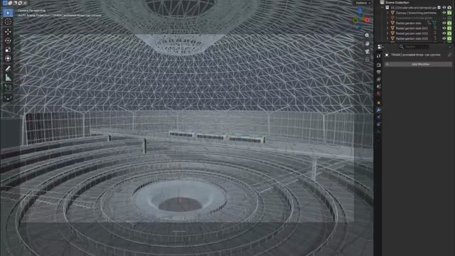
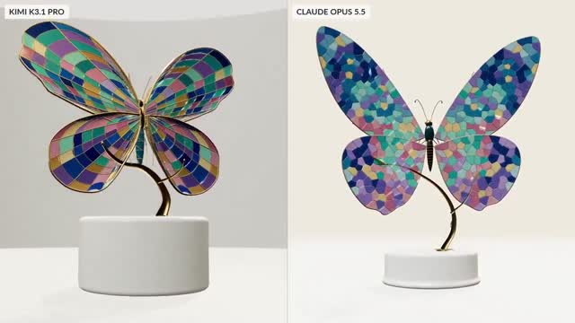
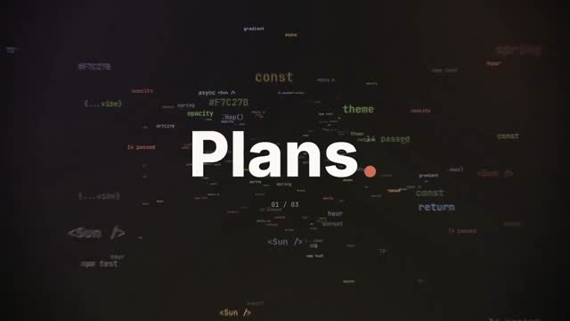

# Awesome Kimi K3.1 Pro Videos

Videos, animations, 3D scenes, and games made with **Kimi K3.1 Pro**, with prompts shared by their creators and links to the original posts.

Pick a video, copy its prompt, and try it with your own agent.

**[▶ Watch all 9 videos on SkillU](https://skillu.dev/ai-videos/kimi-k3-1-pro/?utm_source=github&utm_medium=readme&utm_campaign=kimi-k3-1-pro-videos)**

- **9** videos to browse by category
- **2** shared prompts in [prompts/](prompts/)
- Every entry links to the creator’s original post

## Contents

- [Motion graphics & animation](#motion) · 2
- [3D scenes](#3d) · 3
- [Games & interactive](#games) · 1
- [Video workflows](#video) · 2
- [Official showcase](#official) · 1
- [How to use a prompt](#how-to-use-a-prompt)
- [Credits](#credits)

## Motion graphics & animation

<table>
<tr>
<td width="33%" valign="top"> <b>Pelican Riding a Bicycle</b> <a href="https://x.com/zstmfhy/status/2113804589174862231">@zstmfhy</a> · <a href="prompts/pelican-bicycle.md">Prompt</a> An SVG pelican cycling animation, comparing standard and extreme modes.</td>
<td width="33%" valign="top"> <b>Motion With Intent</b> <a href="https://x.com/renoiseai/status/2113689744014209045">@renoiseai</a> · <a href="prompts/motion-with-intent.md">Prompt</a> A 15-second motion graphics piece exploring rhythm, easing, morphing, and contrast.</td>
</tr>
</table>

## 3D scenes

<table>
<tr>
<td width="33%" valign="top"> <b>Robotic Hand: 2,317 Parts</b> <a href="https://x.com/crystalsssup/status/2113684128734625948">@crystalsssup</a> · <a href="https://x.com/crystalsssup/status/2113684128734625948">Original post</a> An interactive 3D website showing a robotic hand being disassembled and reassembled.</td>
<td width="33%" valign="top"> <b>Singapore Changi Airport in Blender</b> <a href="https://x.com/crystalsssup/status/2113698280991580577">@crystalsssup</a> · <a href="https://x.com/crystalsssup/status/2113698280991580577">Original post</a> A Singapore Changi Airport scene built in Blender, from 3D assets and trees to scene assembly and rendering.</td>
<td width="33%" valign="top"> <b>Stained-Glass Butterfly</b> <a href="https://x.com/ivanainai/status/2113775873786794218">@ivanainai</a> · <a href="https://x.com/ivanainai/status/2113775873786794218">Original post</a> An interactive 3D stained-glass butterfly, compared with an Opus 5.5 version made from the same prompt.</td>
</tr>
</table>

## Games & interactive

<table>
<tr>
<td width="33%" valign="top"> <b>Spider-Man City Swing</b> <a href="https://x.com/bubbubbdex/status/2113701194187059221">@bubbubbdex</a> · <a href="https://x.com/bubbubbdex/status/2113701194187059221">Original post</a> Web swinging, rooftop jumps, and street combat in a Manhattan scene.</td>
</tr>
</table>

## Video workflows

<table>
<tr>
<td width="33%" valign="top"> <b>Filmmaking with Renoise</b> <a href="https://x.com/renoiseai/status/2113693742163218695">@renoiseai</a> · <a href="https://x.com/renoiseai/status/2113693742163218695">Original post</a> Kimi plans shots and edits a film through Renoise MCP.</td>
<td width="33%" valign="top"> <b>Trailer for Claude Code</b> <a href="https://x.com/ChrisGPT/status/2113796109722153067">@ChrisGPT</a> · <a href="https://x.com/ChrisGPT/status/2113796109722153067">Original post</a> A Claude Code trailer made with Kimi K3.1 Pro.</td>
</tr>
</table>

## Official showcase

<table>
<tr>
<td width="33%" valign="top"> <b>Kimi K3.1 Pro Official Showcase</b> <a href="https://x.com/Kimi_Moonshot/status/2113681863109939271">@Kimi_Moonshot</a> · <a href="https://x.com/Kimi_Moonshot/status/2113681863109939271">Original post</a> The video showcase shared by the official Kimi account.</td>
</tr>
</table>

## How to use a prompt

1. Open a prompt file and copy the block under **Prompt**.
2. Paste it into an agent running Kimi K3.1 Pro.
3. Ask it to create the animation or scene, then preview and export the result.

Some creators shared only part of their prompt or described the result in their post; those files say so.

## Credits

Every video and prompt belongs to its creator, linked from each entry. To request a correction or removal, open an issue.

Browse the full collection on **[SkillU](https://skillu.dev/ai-videos/kimi-k3-1-pro/?utm_source=github&utm_medium=readme&utm_campaign=kimi-k3-1-pro-videos)**, or [get video creation skills](https://skillu.dev/skills/) to make your own.
