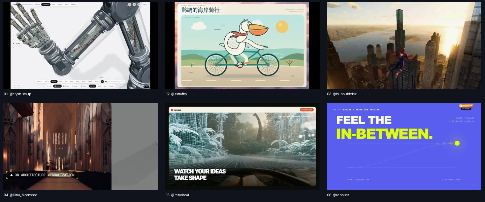
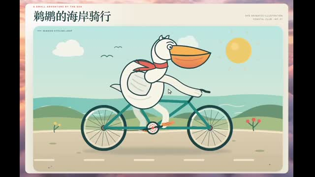
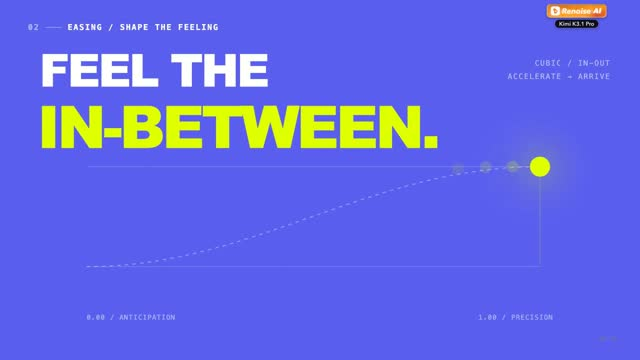
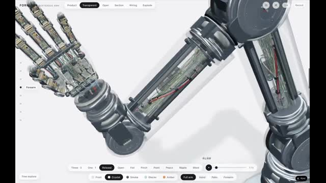
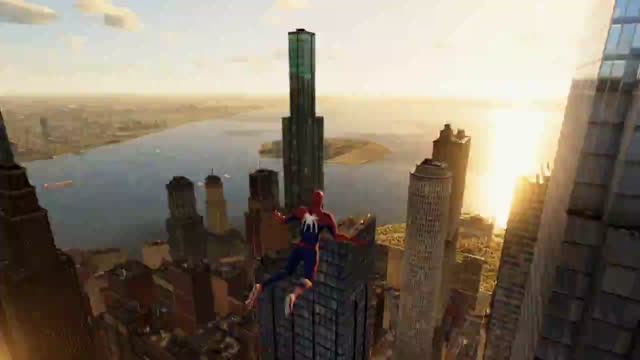
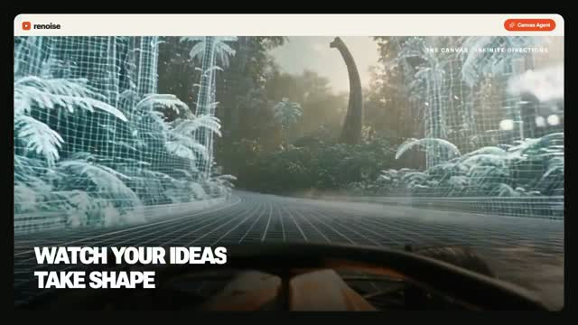
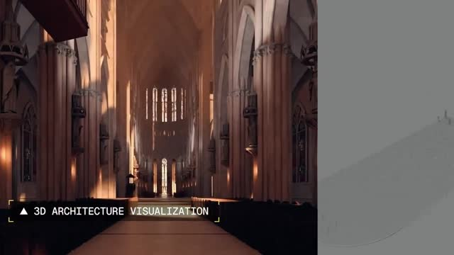

# Awesome Kimi K3.1 Pro Videos

收集用 Kimi K3.1 Pro 制作的动画、3D 场景与视频，保留作者原帖和公开提示词。点击预览观看原视频。

[English](README.en.md) · [贡献作品](CONTRIBUTING.md) · [目录数据](data/videos.json)

已收录 **6** 个作品，其中 **2** 个有公开的完整或部分提示词。

## 视频帧图片墙

[](https://skillu.dev/skills/?utm_source=github&utm_medium=readme&utm_campaign=kimi-k3-1-pro-videos)

[在 SkillU 浏览可获取的 Skill](https://skillu.dev/skills/?utm_source=github&utm_medium=readme&utm_campaign=kimi-k3-1-pro-videos)

## 目录

- [动态图形与动画](#motion) · 2
- [3D 场景](#3d) · 1
- [游戏与交互](#games) · 1
- [视频工作流](#video) · 1
- [官方展示](#official) · 1
- [使用提示词](#使用提示词)
- [添加作品与重新生成](#添加作品与重新生成)

<a id="motion"></a>

## 动态图形与动画

<table>
<tr>
<td width="33%" valign="top"><a href="https://x.com/zstmfhy/status/2113804589174862231"></a><br><b>鹈鹕骑自行车</b><br><a href="https://x.com/zstmfhy/status/2113804589174862231">@zstmfhy</a> · <a href="prompts/pelican-bicycle.md">完整 Prompt</a><br><sub>SVG 绘制的鹈鹕骑车动画，原帖对比标准模式和极致模式。</sub></td>
<td width="33%" valign="top"><a href="https://x.com/renoiseai/status/2113689744014209045"></a><br><b>Motion With Intent</b><br><a href="https://x.com/renoiseai/status/2113689744014209045">@renoiseai</a> · <a href="prompts/motion-with-intent.md">完整 Prompt</a><br><sub>15 秒动态图形，包含节奏、缓动、变形与对比。</sub></td>
</tr>
</table>

<a id="3d"></a>

## 3D 场景

<table>
<tr>
<td width="33%" valign="top"><a href="https://x.com/crystalsssup/status/2113684128734625948"></a><br><b>机械手的 2,317 个部件</b><br><a href="https://x.com/crystalsssup/status/2113684128734625948">@crystalsssup</a> · <a href="prompts/robotic-hand.md">作品说明</a><br><sub>机械手拆解与装配的交互式 3D 网站。</sub></td>
</tr>
</table>

<a id="games"></a>

## 游戏与交互

<table>
<tr>
<td width="33%" valign="top"><a href="https://x.com/bubbubbdex/status/2113701194187059221"></a><br><b>蜘蛛侠城市穿行</b><br><a href="https://x.com/bubbubbdex/status/2113701194187059221">@bubbubbdex</a> · <a href="prompts/spider-city.md">作品说明</a><br><sub>曼哈顿场景中的荡网移动、屋顶跳跃和街头战斗。</sub></td>
</tr>
</table>

<a id="video"></a>

## 视频工作流

<table>
<tr>
<td width="33%" valign="top"><a href="https://x.com/renoiseai/status/2113693742163218695"></a><br><b>Renoise 影片创作</b><br><a href="https://x.com/renoiseai/status/2113693742163218695">@renoiseai</a> · <a href="prompts/motion-trailer.md">作品说明</a><br><sub>Kimi 通过 Renoise MCP 编排镜头并剪辑影片。</sub></td>
</tr>
</table>

<a id="official"></a>

## 官方展示

<table>
<tr>
<td width="33%" valign="top"><a href="https://x.com/Kimi_Moonshot/status/2113681863109939271"></a><br><b>Kimi K3.1 Pro 官方展示</b><br><a href="https://x.com/Kimi_Moonshot/status/2113681863109939271">@Kimi_Moonshot</a> · <a href="prompts/official-showcase.md">作品说明</a><br><sub>Kimi 官方发布的视频展示。</sub></td>
</tr>
</table>

## 使用提示词

打开标有完整 Prompt 或 Prompt 片段的作品页，复制作者公开的内容，交给运行 Kimi K3.1 Pro 的 Agent。根据作品需要准备素材和运行环境，再预览、调整与导出。需要额外视频工具的流程会在作品页标注。

[查看 SkillU 的相关 Skill](https://skillu.dev/skills/) · [网站导出数据](data/site-feed.json)

## 添加作品与重新生成

需要 Python 3.10+、FFmpeg 和 ffprobe。视频缓存在本地 `.cache/`，仓库只保存抽取的预览帧和目录。

```sh
python3 -m venv .venv
.venv/bin/pip install -r requirements.txt
# 向 data/videos.json 追加条目后，一条命令更新图片墙、README 和提示词页面
.venv/bin/python scripts/gallery.py build
# 只处理一个作品；仍会重新生成完整索引
.venv/bin/python scripts/gallery.py build --only pelican-bicycle
# 改选该作品的帧位置后重新抽帧
.venv/bin/python scripts/gallery.py build --only pelican-bicycle --force
# 不下载视频，只更新文档与已有图片的合集
.venv/bin/python scripts/gallery.py render
.venv/bin/python scripts/gallery.py validate
```

抽帧默认取视频 40% 的位置，可用 `frame_ratio` 调整。多视频原帖通过 `video_index` 选择，从 1 开始。相同来源与帧位置会复用缓存；失败时保留已有图片，命令以非零状态退出并列出失败项。

## 收录规则

作者原帖须明确关联 Kimi K3.1 Pro；保留原始出处。公开完整提示词、公开片段和未公开三种状态分别记录，不从视频反推作者提示词。涉及其他模型的对比视频会在作品页注明。作者自报的效果、耗时和费用不作为统一测评结论。

代码采用 MIT 许可。第三方视频、预览帧、提示词和商标的权利归原作者，不因收录而变为 MIT 许可；需要复用时请查阅原帖许可或联系作者。作品归属或收录有误可提交 Issue 更正或移除。

组织方式参考 [Awesome Opus 5.5 Videos](https://github.com/yihui-dev/awesome-opus5-5-videos)。本项目独立维护。
